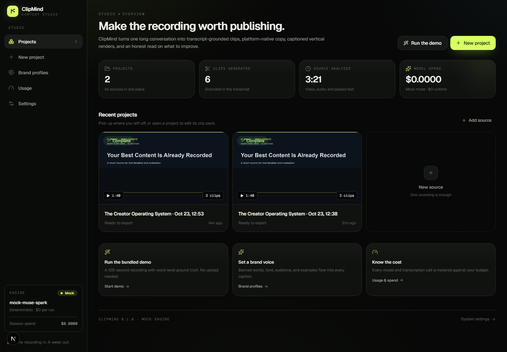

# ClipMind

**Turn one long recording into a publishable clip pack — transcript-grounded, on-brand, and cost-aware.**

ClipMind is a full-stack multimodal content-intelligence studio. Upload a long video, audio file, or pasted transcript. ClipMind produces a word-level transcript, selects the strongest moments, writes platform-native copy, renders 9:16 captioned clips, summarizes the source, and scores the result — with a brand voice and a hard budget guard.

The entire product runs **offline in `MOCK_MODE=true` at $0** with deterministic AI. Switching to the Meta Model API is a configuration change, not a code change.



## What is in the box

- **Ingest** — video, audio, and pasted text; FFmpeg normalization, metadata probe, keyframes, duration/size limits, rights attestation.
- **Word-level transcript** — Meta Muse Voice Transcribe (10-minute chunks), optional local faster-whisper, bundled sample ground truth, or a canned mock transcript.
- **Grounded clip selection** — deterministic candidate scoring + model proposal + self-critique + quote/boundary validation. A clip cannot survive with an invented quote or an out-of-range timestamp.
- **Platform copy** — Instagram, YouTube Shorts, TikTok, LinkedIn, and X variants with hooks, hashtags, and CTAs; brand tone, audience, examples, and banned words are enforced at generation and on every manual save.
- **Vertical renders** — 1080×1920 MP4 with burned-in ASS captions; landscape sources get a blurred, darkened canvas and a centered full frame; SRT and thumbnails included.
- **Summaries and insights** — TL;DR, takeaways, chapters, verified quotes, structural metrics (WPM, pauses, filler rate), and per-clip scorecards with honest confidence labels.
- **Studio UI** — dashboard, upload flow, live SSE pipeline progress, project workspace, clip editor with trim/copy/regenerate/re-render, brand profiles, usage/cost ledger, and settings.
- **Export** — one ZIP with rendered clips, SRTs, thumbnails, `copy.csv`, `summary.md`, `insights.json`, and a manifest.
- **Cost tracking** — every model and ASR call is metered against `MAX_BUDGET_USD`; cached calls are tracked separately.
- **Ops** — Docker Compose, Makefile, pytest, Playwright smoke test, demo seeder, and an 81-check acceptance eval.

## Quickstart (mock mode, $0)

**Prerequisites:** Python 3.11+, Node.js 20+, FFmpeg 6+ on `PATH`. Windows, macOS, and Linux are supported.

```bash
cp .env.example .env
python -m venv .venv

# Windows
.venv\Scripts\activate
# macOS / Linux
# source .venv/bin/activate

pip install -e "./backend[dev]"
cd frontend && npm ci && cd ..

python scripts/dev.py
```

Open **http://localhost:3000**. Click **Run the demo** on the dashboard, or run the demo from the CLI:

```bash
python scripts/demo.py
```

The demo uses a bundled 100-second recording with a SHA256-keyed, word-level ground-truth transcript. It runs the full pipeline and renders vertical clips locally. No API key is required.

If `python scripts/dev.py` is not convenient, run the two services in separate terminals:

```bash
# terminal 1
cd backend
..\.venv\Scripts\python.exe -m uvicorn app.main:app --reload --port 8000

# terminal 2
cd frontend
npm run dev
```

## Use the real Meta Model API

```dotenv
MOCK_MODE=false
PROVIDER=meta
MODEL_API_KEY=your_key_here
```

Restart the backend. The defaults target:

| Purpose | Model |
| --- | --- |
| Reasoning, selection, copy, summaries, insights | `muse-spark-1.3` |
| Speech-to-text | `muse-voice-transcribe-1.0` |

The Meta provider uses the Responses API (`POST /responses`) with `text.format` JSON schema output, retries on 408/409/429/5xx, a JSON repair pass, response caching, and a pre-call budget guard. See [docs/DECISIONS.md](docs/DECISIONS.md) for the API decisions and the `TODO(verify)` items.

> **Verification note:** no real Meta API key was available while this repository was built. Mock mode is fully verified; the real-provider path is implemented from the current Meta docs but has not been smoke-tested against the live service. Do not claim live-provider verification until a key is available.

## Docker

```bash
cp .env.example .env
docker compose up --build
```

- UI: http://localhost:3000
- API: http://localhost:8000
- API docs: http://localhost:8000/docs

The backend container includes FFmpeg and stores data in the `clipmind-data` volume. To reset everything:

```bash
docker compose down -v
```

To build the frontend for a non-local API URL, set `NEXT_PUBLIC_API_URL` before `docker compose build` (it is compiled into the browser bundle).

## How the pipeline works

```text
upload ──► ingest ──► transcribe ──► understand ──► select ──► copy + summary ──► render ──► insights
             │            │              │             │             │                │            │
        normalize,     word-level     topics +      grounded      platform      1080×1920     metrics +
        probe, frames  timings        energy        candidates    variants      captions      scorecards
                                                         │
                                                  quote + boundary
                                                  + brand validation
```

Stages are persisted as JSON checkpoints. A failed stage retries once, then fails the job with a readable error. Interrupted jobs are re-queued on startup (`AUTO_RESUME_JOBS=true`), and completed stages are not repeated. The frontend consumes server-sent events at `/api/jobs/{id}/events` and falls back to polling if SSE drops.

### Grounding and safety

- Candidate moments are generated deterministically from transcript words, then a model proposes and critiques selections.
- Every quote is checked against the source transcript. An ungrounded quote is corrected or dropped; it is never presented as verbatim.
- Clip boundaries snap to word timings and are clamped to the source duration.
- Banned words are checked with whole-word, case-insensitive matching on generation and on manual edits. Violations return `422` and do not persist.
- Risky language produces review flags rather than silent approval.
- Engagement scores are explicitly labeled as modeled estimates, not platform guarantees.

### Cost controls

- Prices are configuration, not hard-coded in prompts: `META_INPUT_PRICE_PER_M`, `META_CACHED_INPUT_PRICE_PER_M`, `META_OUTPUT_PRICE_PER_M`.
- `MAX_BUDGET_USD` is checked before each model call and during ASR. A run stops with `BudgetExceeded` rather than overspending.
- Every call is stored in SQLite with tokens, latency, cache hit, purpose, and cost. The Usage page and `/api/usage` expose totals, remaining budget, and remaining hackathon credits.
- Mock calls are recorded with `$0.00` cost so the same UI and accounting path is exercised.

## Acceptance checks

```bash
# Backend: API, pipeline, sample media, grounding, captions
cd backend
..\.venv\Scripts\python.exe -m pytest -q

# Frontend: types, lint, production build
cd frontend
npm run typecheck
npm run lint
npm run build

# Browser smoke test (backend + frontend running)
npm run test:e2e

# End-to-end acceptance eval, writes data/evals/latest.json
cd ..
.\.venv\Scripts\python.exe scripts\eval.py
```

The eval checks 81 properties on a fresh run (80 stored-project properties plus pipeline completion), including word timings, quote grounding, clip bounds and non-overlap, platform coverage, caption limits, brand safety, 1080×1920 renders, SRT contents, summary quote grounding, insight coverage, export contents, and zero-cost mock accounting. See [docs/EVALS.md](docs/EVALS.md) for the latest result.

## Project layout

```text
backend/
  app/
    api/            projects, uploads, jobs/SSE, clips, brands, insights, export, media
    pipeline/       ingest, transcribe, understand, select, copy, summary, render, insights, orchestrator
    providers/      provider interface, Meta Responses API, deterministic mock
    services/       ASR, cache, costs, prompts, storage, transcript/SRT/ASS utilities
    prompts/        versioned prompt templates
    models.py       SQLModel tables
    schemas.py      Pydantic API contracts
  samples/          demo media + SHA256-keyed word-level transcripts
  tests/            pytest acceptance and unit tests
frontend/
  src/app/          dashboard, new project, workspace, clip studio, brands, usage, settings
  src/components/   studio shell, upload, pipeline progress, clip cards, panels, UI primitives
  src/hooks/        SSE job stream with polling fallback
  e2e/              Playwright smoke test
scripts/            dev, demo, seed, eval, sample generation, API helpers
docs/               architecture, API, decisions, credits, evals, progress, demo, submission
```

## Configuration

Copy `.env.example` to `.env`. The most important settings:

| Variable | Default | Meaning |
| --- | --- | --- |
| `MOCK_MODE` | `true` | Run the full pipeline with deterministic mock AI at $0 |
| `PROVIDER` | `mock` | `mock` or `meta` |
| `MODEL_API_KEY` | empty | Meta Model API key (Bearer token) |
| `META_MODEL` | `muse-spark-1.3` | Reasoning model |
| `META_ASR_MODEL` | `muse-voice-transcribe-1.0` | Speech-to-text model |
| `USE_META_ASR` | `true` | Use Meta ASR when a key is present |
| `MAX_BUDGET_USD` | `100` | Hard spend ceiling |
| `DATA_DIR` | `./data` | Uploads, processed media, renders, cache, SQLite |
| `MAX_UPLOAD_MB` | `500` | Upload size limit |
| `MAX_DURATION_S` | `7200` | Source duration limit |
| `JOB_CONCURRENCY` | `1` | In-process worker count |
| `CORS_ORIGINS` | `http://localhost:3000,...` | Allowed browser origins |
| `NEXT_PUBLIC_API_URL` | `http://localhost:8000` | Browser-visible API URL |

See `.env.example` for the complete list, including ASR fallback and rate limiting.

## API

Interactive docs: **http://localhost:8000/docs**. A concise endpoint reference with SSE examples is in [docs/API.md](docs/API.md).

Core endpoints:

- `POST /api/projects`, `GET /api/projects`, `GET/PATCH/DELETE /api/projects/{id}`
- `POST /api/projects/{id}/upload` (multipart file or pasted text)
- `POST /api/projects/{id}/process`, `GET /api/jobs/{id}`, `GET /api/jobs/{id}/events`
- `GET /api/projects/{id}/transcript|summary|insights|export`
- `GET/PATCH /api/clips/{id}`, `POST /api/clips/{id}/regenerate|render`
- `GET/POST /api/brand-profiles`, `GET/PATCH/DELETE /api/brand-profiles/{id}`
- `GET /api/usage`, `GET /api/usage/calls`, `GET /api/system`, `GET /api/health`
- `POST /api/demo-project` (one-click demo source)

## Docs

- [Architecture](docs/ARCHITECTURE.md) — components, data model, pipeline, failure handling.
- [API reference](docs/API.md) — requests, responses, SSE, export.
- [Decisions](docs/DECISIONS.md) — what was chosen and why, including unresolved `TODO(verify)` items.
- [Credits](docs/CREDITS.md) — references, learned patterns, and dependency notes.
- [Evals](docs/EVALS.md) — what is checked, latest results, and limitations.
- [Progress](docs/PROGRESS.md) — phase-by-phase build log.
- [Demo script](docs/DEMO.md) — a three-minute walkthrough and preflight checklist.
- [Submission](docs/SUBMISSION.md) — final checklist and judging map.

## Known limitations

- The job queue is in-process and single-node; it is correct for a demo but not a durable distributed queue.
- There is no authentication or multi-tenancy. Do not expose a production deployment without adding both.
- In mock mode, arbitrary uploaded media uses a canned transcript unless its SHA256 is in `backend/samples/transcripts.json` or `FORCE_WHISPER=true` with faster-whisper installed. The bundled demo is fully grounded.
- Real Meta API behavior could not be verified without a key; see the note above.
- Rendering is CPU-bound and serialized by `JOB_CONCURRENCY=1` by default.
- Engagement predictions are estimates from transcript structure, not platform telemetry.
- Publishing to social platforms is intentionally out of scope; ClipMind exports a review-ready pack.

## Credits

ClipMind was built for the Meta Model API hackathon. It uses the current Meta Model API docs as the source of truth for model IDs and request shapes, and documents learned patterns and references in [docs/CREDITS.md](docs/CREDITS.md). No reference-project code was copied. Demo media and transcripts were generated locally for this repository.
